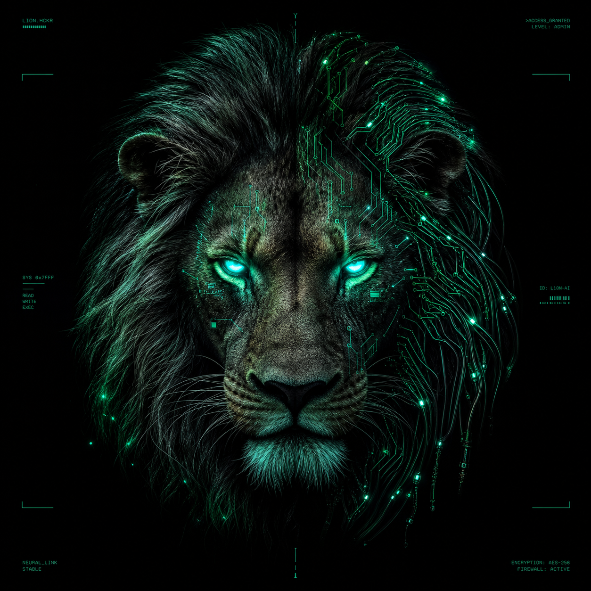

# 😼 SysK69 — Portfolio

**Security engineer & developer** · offensive security · automation · full-stack apps
PRO HACKER · team [Sh4d0wC4ts](https://app.hackthebox.com/teams/8832)

### 👉 **[Apri il portfolio → sysk69.github.io](https://sysk69.github.io/)**

*"Curiosity didn't kill this cat — it got root."*

---

Questo repo serve il sito **[sysk69.github.io](https://sysk69.github.io/)** (GitHub Pages).
È una landing statica (HTML/CSS) che raccoglie i miei progetti:

- 📝 **[HTB-Writeups](https://sysk69.github.io/HTB-Writeups/)** — writeup CTF
- 🛠️ **[Kali-Setup](https://sysk69.github.io/Kali-Setup/)** — ambiente Kali come codice

😼 Sh4d0wC4ts — "Some shadows don't have a source."

